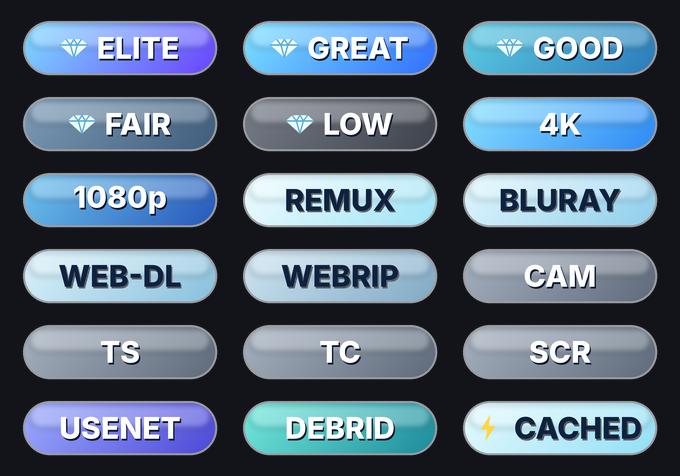

# Nuvio Diamond Badges

Ice-style Fusion badges for Nuvio, built to match the AIOStreams "💎 rating" formatter.

| Group | Badges |
|---|---|
| 💎 Rating | ELITE (5💎) · GREAT (4💎) · GOOD (3💎) · FAIR (2💎) · LOW (1💎) |
| Resolution | 4K · 1080p |
| Source | REMUX · BLURAY · WEB-DL · WEBRIP · CAM · TS · TC · SCR |
| Delivery | CACHED · USENET · DEBRID |

Badges match the stream **description**, so they only work with the matching
AIOStreams formatter (included in the config file this pack came with).

## Hosting on GitHub (free, ~5 minutes)

1. Sign in at github.com → **New repository** → name it `nuvio-diamond-badges`,
   set it to **Public**, tick "Add a README" → **Create repository**.
2. Click **Add file → Upload files** and drag in the `badges` folder and
   `badges.json` (and `preview.png` if you like) → **Commit changes**.
3. Open `badges.json` in the repo → pencil icon → replace
   `YOUR_GITHUB_USERNAME` with your GitHub username (it appears 18 times —
   use the editor's find/replace, Ctrl+F / Cmd+F) → **Commit changes**.
4. Your badge URL is:
   `https://raw.githubusercontent.com/<your-username>/nuvio-diamond-badges/main/badges.json`
   Open it in a browser to check it loads.

## Add to Nuvio

Settings → General → Layout → Streams → **Fusion badge URLs** → paste the URL.
Nuvio uses one badge set at a time, so remove or disable any other set.
